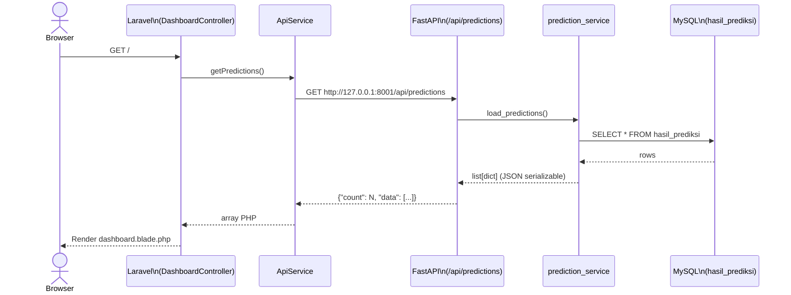

# Panduan Teknis — Sistem Prediksi Tanggal Habis Saldo ATM

## 1. Ringkasan Proyek

Proyek ini adalah sistem prediksi tanggal habis saldo ATM yang menggabungkan:

- preprocessing data ATM dari MySQL,
- feature engineering berbasis kalender dan trend,
- model machine learning (LightGBM dengan fallback ke RandomForest),
- rule business logic untuk validasi dan fallback,
- scheduler otomatis untuk prediksi realtime dan retraining,
- dashboard Laravel yang menampilkan hasil akhir dari `hasil_prediksi`.

Tujuan utamanya adalah memberi estimasi kapan saldo ATM akan habis agar operasional pengisian dana bisa direncanakan lebih dini dan lebih aman.

---

## 2. Arsitektur Sistem

### 2.1 Backend Python

Backend utama berada di folder `backend`, dan berisi:

- `app/main.py` → entrypoint FastAPI
- `app/scheduler.py` → scheduler APScheduler
- `app/api/routes/predictions.py` → endpoint API
- `app/services/prediction_service.py` → query DB ke `hasil_prediksi`
- `scripts/data_preprocessing.py` → preprocessing dan feature engineering
- `scripts/train_model.py` → training model dan evaluasi
- `scripts/predict_realtime.py` → prediksi realtime dan fallback rule
- `config/config.py` → konfigurasi DB dan environment

### 2.2 Frontend Laravel

Frontend berada di folder `frontend` dan berisi:

- `app/Http/Controllers/DashboardController.php` → ambil data dari API dan kirim ke Blade
- `app/Services/ApiService.php` → HTTP client ke FastAPI
- `resources/views/dashboard.blade.php` → tampilan dashboard

### 2.3 Database

Database utama yang dipakai saat ini adalah MySQL dengan tabel yang relevan:

- `data_2026` → data raw ATM
- `preprocessing` → data hasil preprocessing dan feature engineering
- `hasil_prediksi` → hasil prediksi final per TID

---

## 3. Alur Sistem yang Benar di Proyek Ini

### 3.1 Flow data end-to-end

```text
data_2026 (MySQL)
    ↓
preprocessing
    ↓
train_model.py
    ↓
model + scaler + fitur.pkl
    ↓
predict_realtime.py
    ↓
hasil_prediksi
    ↓
FastAPI /api/predictions
    ↓
Laravel dashboard
```

### 3.2 Penjelasan arahnya

1. Data raw ATM diproses di `data_preprocessing.py`.
2. Hasil preprocessing disimpan ke tabel `preprocessing`.
3. Model dilatih ulang dari `preprocessing` menggunakan `train_model.py`.
4. Saat realtime job berjalan, `predict_realtime.py` membaca data terbaru per TID dari `preprocessing`.
5. Model memprediksi `prediksi_hari` lalu dikonversi menjadi status operasional.
6. Jika hasil model terlalu berbeda dari business rule, maka fallback rule diterapkan.
7. Hasil final di-upsert ke `hasil_prediksi`.
8. Laravel mengambil data dari `hasil_prediksi` melalui FastAPI.

---

## 4. Preprocessing dan Fitur yang Dipakai

File yang bertanggung jawab: `backend/scripts/data_preprocessing.py`

### 4.1 Tujuan preprocessing

Preprocessing bertugas:

- membaca data ATM harian dari `data_2026`,
- mengelompokkan per TID,
- menghitung indikator seperti `total_lmb`, `pagu_existing`, `sisa_pagu`, `ratas_harian`,
- menghitung feature kalender seperti weekend, holiday, payday,
- menambahkan feature rolling, lag, cumulative, dan interaction,
- menyimpan hasilnya ke tabel `preprocessing`.

### 4.2 Fitur yang dihasilkan

Beberapa fitur utama yang dipakai model:

- `sisa_pagu`
- `ratas_harian`
- `selisih_lmb`
- `hari`, `bulan`, `tahun`, `hari_ke`, `kuartal`
- `is_weekend`, `is_payday`, `is_holiday`
- `days_to_payday`, `days_since_payday`
- `rolling_7d`, `rolling_14d`, `rolling_30d`
- `trend_7d_ratio`, `trend_14d_ratio`
- `lag_1_ratas`, `lag_7_ratas`, `lag_14_ratas`
- feature interaction seperti `weekend_x_trend`, `payday_x_trend`, `holiday_x_trend`

Semua fitur ini harus ada pada data yang digunakan untuk training dan inference agar model tetap konsisten.

---

## 5. Rule Bisnis yang Digunakan

### 5.1 Aturan status final

Aturan status yang dipakai secara konsisten adalah:

- `<= 1 hari` → `🔴 Kritis`
- `2 sampai 3 hari` → `🟠 Waspada`
- `> 3 hari` → `🟢 Aman`

Implementasinya ada di `backend/scripts/predict_realtime.py` dengan fungsi:

- `status_from_hari(hari)`

Ini adalah sumber status yang seharusnya dipakai di semua layer untuk menjaga konsistensi.

### 5.2 Rule business-day untuk fallback

Fungsi `business_rule_days(sisa_pagu, ratas_harian)` menghitung estimasi hari habis sebagai berikut:

- kalau `sisa_pagu < ratas_harian` → `0`
- kalau `sisa_pagu >= ratas_harian` → `int(sisa_pagu / ratas_harian) - 1`

Di `apply_business_rule_fallback()` logic-nya adalah:

- hitung `business_rule_hari`
- hitung selisih absolut terhadap `prediksi_hari`
- hitung persentase selisih relatif terhadap `business_rule_hari`
- jika persentase selisih `> 50%`, maka prediksi model diganti dengan `business_rule_hari`

Artinya, fallback ini hanya terjadi untuk kasus yang benar-benar jauh dari rule bisnis, bukan untuk semua TID.

### 5.3 Catatan penting: satu sumber aturan

Untuk menjaga hasil dashboard sama dengan hasil scheduler/backend, aturan status harus dipakai di satu fungsi tunggal. Di proyek saat ini, yang dipakai sebagai sumber utama adalah `status_from_hari()`, lalu frontend di dashboard memprioritaskan `prediksi_hari` sebelum membaca `threshold` string.

---

## 6. Model yang Dipakai

### 6.1 Algoritma

Pada training, model utama adalah:

- `LightGBMRegressor`

Jika LightGBM tidak tersedia atau gagal, maka fallback ke:

- `RandomForestRegressor`

Proses scaling menggunakan:

- `StandardScaler`

### 6.2 Tahapan training

Di `train_model.py`, training dijalankan melalui beberapa tahapan:

1. load data dari `preprocessing`
2. validasi target dengan rule bisnis
3. cleaning dan handling missing value
4. time-series split per TID
5. scaling fitur
6. training model
7. evaluasi: MAE, R², MAPE
8. simpan model ke `backend/models/`

Model yang disimpan di folder `backend/models/` meliputi:

- `model_prediksi_habis.pkl`
- `scaler.pkl`
- `fitur.pkl`

---

## 7. Prediksi Realtime

File utama: `backend/scripts/predict_realtime.py`

### 7.1 Job realtime

Prediksi realtime berjalan melalui fungsi:

- `main()`

Prosesnya:

1. baca record terbaru per TID dari tabel `preprocessing`
2. validasi fitur yang dipakai model
3. load model dan scaler dari disk
4. lakukan `model.predict()`
5. konversi hasil ke `prediksi_hari`
6. hitung `tanggal_habis`
7. assign `threshold` berdasarkan `status_from_hari()`
8. apply fallback rule jika selisih lebih dari 50%
9. upsert hasil ke `hasil_prediksi`

### 7.2 Output yang disimpan

Kolom utama yang dipakai untuk dashboard adalah:

- `tid`
- `updated`
- `total_lmb`
- `pagu_existing`
- `sisa_pagu`
- `ratas_harian`
- `prediksi_hari`
- `tanggal_habis`
- `threshold`
- `prediksi_at`

### 7.3 Distribusi status yang muncul

Hasil distribusi status dihitung dari `prediksi_hari` secara konsisten lewat:

```python
status_from_hari(v)
```

sehingga semua output punya label yang sama.

---

## 8. Scheduler dan Automation

File utama: `backend/app/scheduler.py`

### 8.1 Job 1: realtime prediction

Job ini dijalankan setiap interval menit (default 15 menit):

- preprocessing raw data
- prediksi realtime
- upsert hasil ke `hasil_prediksi`

### 8.2 Job 2: retraining

Job ini dijalankan secara berkala (default tiap minggu pada jam 02.00 WIB):

- full preprocessing
- training ulang model
- prediksi ulang
- reset checkpoint

### 8.3 Variabel environment scheduler

Beberapa variabel yang relevan:

- `PREDICT_INTERVAL_MINUTES` → interval prediksi realtime
- `RETRAIN_DAY_OF_WEEK` → hari retraining
- `RETRAIN_HOUR` → jam retraining
- `SOURCE_TABLE` → nama tabel raw source
- `PREPROCESS_TABLE` → tabel preprocessing
- `PREDICTION_TABLE` → tabel hasil final

---

## 9. API Backend

File: `backend/app/api/routes/predictions.py`

### Endpoint yang tersedia

- `GET /api/predictions` → membaca seluruh data dari `hasil_prediksi`
- `GET /api/predictions/{tid}` → membaca data satu TID
- `GET /health` atau health endpoint → mengecek service hidup

### Format response

Response biasanya berbentuk:

```json
{
  "count": 120,
  "data": [
    {
      "tid": "TID001",
      "updated": "2026-09-09 08:00:00",
      "prediksi_hari": 2,
      "tanggal_habis": "11-09-2026",
      "threshold": "🟠 Waspada"
    }
  ],
  "last_update": "2026-09-09 08:00:00"
}
```

---

## 10. Frontend Dashboard

File utama: `frontend/resources/views/dashboard.blade.php`

### 10.1 Fungsi status di dashboard

Dashboard menghitung status dengan prioritas berikut:

1. jika `prediksi_hari` numerik, maka gunakan `status_from_hari` langsung,
2. jika `prediksi_hari` tidak ada, fallback baca `threshold` string,
3. summary cards menghitung jumlah per status dari `data`.

### 10.2 Tujuan UI

Dashboard menampilkan:

- total ATM,
- rata-rata sisa pagu,
- jumlah kritis, waspada, aman,
- tabel detail per TID,
- filter pencarian dan status,
- rata-rata prediksi hari.

### 10.3 Prinsip konsistensi UI

Untuk menjaga dashboard sama dengan backend, UI tidak boleh memakai aturan status yang berbeda. Logika yang benar adalah:

- ambil `prediksi_hari` sebagai sumber utama,
- ubah ke status dengan fungsi yang sama seperti backend,
- hanya jika data tidak ada, baru parse `threshold`.

---

## 11. Perbedaan Model-Only vs Fallback Final

Dalam implementasi saat ini, ada dua kondisi hasil yang mungkin muncul:

### 11.1 Model-only

Output hanya dari model tanpa business-rule fallback.

- prediksi bersifat murni dari ML,
- status ditentukan dari `prediksi_hari` model,
- biasanya lebih konsisten dengan pola model dan evaluasi training.

### 11.2 Fallback final

Output akhir yang dipakai untuk scheduler / `hasil_prediksi` saat rule fallback aktif.

- model memprediksi nilai awal,
- apabila selisih >50% terhadap rule bisnis, nilai diganti,
- hasil final kemudian disimpan ke DB dan ditampilkan di dashboard.

Dengan kata lain, `hasil_prediksi` bukan selalu model-only; bisa berupa hasil model yang sudah dimodifikasi oleh business rule.

---

## 12. Praktik Konsistensi yang Dipakai Saat Ini

Agar hasil selalu sama di backend, scheduler, dan dashboard, praktik yang disarankan adalah:

- pakai satu fungsi status untuk semua layer,
- simpan status secara konsisten di `threshold`,
- manfaatkan `prediksi_hari` sebagai sumber utama di frontend,
- hindari parsing label string yang berbeda antar layer,
- simpan snapshot data model-only bila perlu untuk audit evaluasi.

---

## 13. Catatan Implementasi Terkini

Beberapa hal yang sudah diterapkan pada proyek saat ini:

- `status_from_hari()` dijadikan fungsi status tunggal di backend.
- frontend dashboard memprioritaskan `prediksi_hari` untuk menentukan status.
- scheduler menjalankan preprocessing + prediksi realtime.
- laporan evaluasi training baru disimpan bila `SAVE_EVAL_REPORTS` diaktifkan.
- fallback business rule ditambahkan pada `predict_realtime.py` untuk menjaga hasil sesuai logika operasional.

---

## 14. Kesimpulan

Sistem ini adalah gabungan dari:

- ML model untuk prediksi jumlah hari habis saldo,
- business rule untuk validasi dan fallback,
- scheduler otomatis untuk update periodik,
- API FastAPI sebagai jembatan data,
- dashboard Laravel untuk eksplorasi dan monitoring.

Kunci utama keberhasilan sistem bukan hanya ketepatan model, tetapi juga konsistensi aturan status dan konsistensi data yang diposting dari backend ke dashboard.

---

## 15. Referensi File Utama

- `backend/scripts/data_preprocessing.py`
- `backend/scripts/train_model.py`
- `backend/scripts/predict_realtime.py`
- `backend/app/scheduler.py`
- `backend/app/api/routes/predictions.py`
- `frontend/resources/views/dashboard.blade.php`
- `frontend/app/Services/ApiService.php`

Dokumen ini dibuat berdasarkan keadaan project yang sedang berjalan, bukan versi awal yang masih generik.
        ↓
Browser (Dashboard)
```

### Sequence Diagram



---

## 6. Data Input

### Sumber Data

Data mentah dibaca dari tabel MySQL `data_2026` (nama tabel dapat dikonfigurasi via `SOURCE_TABLE` di `.env`).

### Query Pengambilan Data

```sql
SELECT tid, updated, lmb1, lmb2, lmb3, lmb4, pagu_existing
FROM data_2026
ORDER BY tid, updated
```

### Struktur Field Input

| Field | Tipe MySQL | Fungsi | Transformasi |
|---|---|---|---|
| `tid` | VARCHAR | ID terminal ATM | Digunakan sebagai kunci grouping |
| `updated` | DATETIME | Timestamp data | Di-parse ke `pd.Timestamp`, diambil `.dt.date` untuk tanggal |
| `lmb1` | BIGINT | Saldo kaset 1 | Dikonversi ke numerik, `fillna(0)` |
| `lmb2` | BIGINT | Saldo kaset 2 | Dikonversi ke numerik, `fillna(0)` |
| `lmb3` | BIGINT | Saldo kaset 3 | Dikonversi ke numerik, `fillna(0)` |
| `lmb4` | BIGINT | Saldo kaset 4 | Dikonversi ke numerik, `fillna(0)` |
| `pagu_existing` | BIGINT | Kapasitas maksimal ATM | Dikonversi ke numerik, `fillna(0)` |

### Validasi dan Cleaning Input

- Nilai non-numerik pada kolom LMB dan `pagu_existing` di-coerce ke NaN kemudian di-`fillna(0)`
- Duplikat per pasangan `(tid, updated)` dihapus (retain satu baris)
- Baris dengan `updated` tidak valid (NaT setelah parsing) akan memiliki fitur kalender bernilai 0

---

## 7. Data Preprocessing

File: `backend/scripts/data_preprocessing.py`  
Fungsi utama: `preprocess(df)`, `feature_engineering(df, engine)`, `save_to_db(df)`

### Tahap 1 — Konversi Tipe Data

**Input:** DataFrame mentah dari `data_2026`  
**Proses:**
- `updated` dikonversi ke `datetime64` menggunakan `pd.to_datetime(..., errors='coerce')`
- `lmb1`–`lmb4` dan `pagu_existing` dikonversi ke numerik, nilai invalid menjadi NaN lalu di-`fillna(0)`
- Kolom `tanggal` dibuat sebagai `updated.dt.date`

**Output:** DataFrame dengan tipe data bersih

---

### Tahap 2 — Hitung `total_lmb`

**Proses:**

$$\text{total\_lmb} = \text{lmb1} + \text{lmb2} + \text{lmb3} + \text{lmb4}$$

---

### Tahap 3 — Sorting dan Deduplikasi

**Proses:**
- Sort berdasarkan `['tid', 'tanggal', 'updated']`
- Drop duplicates berdasarkan `['tid', 'updated']`, pertahankan baris pertama

---

### Tahap 4 — Hitung `selisih_lmb`

**Proses:** Diferensial absolut `total_lmb` dalam satu TID dan tanggal yang sama.

$$\text{selisih\_lmb}_{i} = \left| \text{total\_lmb}_{i} - \text{total\_lmb}_{i-1} \right|$$

Implementasi: `.groupby(['tid', 'tanggal'])['total_lmb'].diff().abs().fillna(0)`

---

### Tahap 5 — Agregasi Harian per TID

**Proses:** Setiap pasangan `(tid, tanggal)` diringkas menjadi satu baris:

| Kolom | Agregasi |
|---|---|
| `updated` | `last` — timestamp terbaru dalam hari itu |
| `lmb1`–`lmb4` | `last` |
| `total_lmb` | `last` |
| `pagu_existing` | `last` |
| `selisih_lmb` | `sum` — total penarikan per hari |

---

### Tahap 6 — Hitung `ratas_harian`

**Proses:** Rata-rata penarikan harian per TID dihitung dari seluruh histori, lalu dibulatkan ke atas.

$$\text{ratas\_harian}_{tid} = \left\lceil \frac{\sum \text{selisih\_lmb}_{tid}}{n\_hari_{tid}} \right\rceil$$

---

### Tahap 7 — Hitung `sisa_pagu`

$$\text{sisa\_pagu} = \max(\text{pagu\_existing} - \text{total\_lmb},\ 0)$$

---

### Tahap 8 — Rolling Features, Lag, dan Cumulative Windows

Semua rolling menggunakan `shift(1)` agar tidak terjadi data leakage (nilai hari ini tidak masuk ke rolling hari ini).

| Fitur | Formula | Keterangan |
|---|---|---|
| `rolling_7d` | `mean(selisih_lmb[-7..-1])` | Moving average 7 hari |
| `rolling_14d` | `mean(selisih_lmb[-14..-1])` | Moving average 14 hari |
| `rolling_30d` | `mean(selisih_lmb[-30..-1])` | Moving average 30 hari |
| `rolling_std_7d` | `std(selisih_lmb[-7..-1])` | Volatilitas 7 hari |
| `rolling_std_14d` | `std(selisih_lmb[-14..-1])` | Volatilitas 14 hari |
| `rolling_7d_ratio` | `rolling_7d / rolling_14d` | Rasio short vs medium term |
| `trend_7d_ratio` | `selisih_lmb / rolling_7d` | Hari ini vs tren 7 hari |
| `trend_14d_ratio` | `selisih_lmb / rolling_14d` | Hari ini vs tren 14 hari |
| `lag_1_ratas` | `ratas_harian.shift(1)` per TID | Lag 1 hari |
| `lag_7_ratas` | `ratas_harian.shift(7)` per TID | Lag 7 hari |
| `lag_14_ratas` | `ratas_harian.shift(14)` per TID | Lag 14 hari |
| `lag_7_sisa_pagu` | `sisa_pagu.shift(7)` per TID | Sisa pagu 7 hari lalu |
| `cum_prev_3d` | `sum(selisih_lmb[-3..-1])` | Kumulatif 3 hari sebelumnya |
| `cum_prev_7d` | `sum(selisih_lmb[-7..-1])` | Kumulatif 7 hari sebelumnya |
| `cum_prev_14d` | `sum(selisih_lmb[-14..-1])` | Kumulatif 14 hari sebelumnya |
| `event_uplift` | `rolling_7d / rolling_30d` | Proxy surge event |

---

### Tahap 9 — Hitung Target Training

$$\text{jumlah\_hari} = \left\lceil \frac{\text{sisa\_pagu}}{\text{ratas\_harian}} \right\rceil$$

$$\text{tanggal\_habis} = \text{updated} + \text{jumlah\_hari hari}$$

`jumlah_hari` adalah target (`y`) untuk training model ML. Ini merupakan estimasi berbasis business rule, bukan ground truth dari event pengisian ulang aktual.

---

### Tahap 10 — Simpan ke Database

- Disimpan ke tabel `preprocessing` menggunakan `df.to_sql(..., if_exists='replace', ...)`
- Tabel selalu di-replace setiap kali script dijalankan
- Dtype setiap kolom dipetakan secara eksplisit ke tipe SQLAlchemy (BIGINT, Integer, SmallInteger, Float, String, Date, DateTime)

---

## 8. Feature Engineering

File: `backend/scripts/data_preprocessing.py` fungsi `feature_engineering()`, dan `backend/scripts/calendar_features.py`

### Tabel Lengkap Fitur Model

Model menggunakan tepat **48 fitur** yang didefinisikan di konstanta `FITUR_ML` dalam `train_model.py`.

#### Kelompok 1 — Balance & Usage (3 fitur)

| No | Fitur | Tipe | Formula/Logic |
|---|---|---|---|
| 1 | `sisa_pagu` | INT | `max(pagu_existing - total_lmb, 0)` |
| 2 | `ratas_harian` | INT | `ceil(mean(selisih_lmb per TID))` |
| 3 | `selisih_lmb` | INT | Total penarikan per hari (sum diff `total_lmb` dalam hari) |

#### Kelompok 2 — Kalender Dasar (5 fitur)

| No | Fitur | Tipe | Formula/Logic |
|---|---|---|---|
| 4 | `hari` | SMALLINT | `updated.dt.day` (1–31) |
| 5 | `bulan` | SMALLINT | `updated.dt.month` (1–12) |
| 6 | `tahun` | SMALLINT | `updated.dt.year` |
| 7 | `hari_ke` | SMALLINT | `updated.dt.dayofyear` (1–366) |
| 8 | `kuartal` | SMALLINT | `updated.dt.quarter` (1–4) |

#### Kelompok 3 — Cyclic Encoding (6 fitur)

Cyclic encoding memungkinkan model memahami bahwa hari ke-31 dan hari ke-1 berdekatan secara periodik.

| No | Fitur | Formula |
|---|---|---|
| 9 | `hari_sin` | $\sin\left(\frac{2\pi \cdot \text{hari}}{31}\right)$ |
| 10 | `hari_cos` | $\cos\left(\frac{2\pi \cdot \text{hari}}{31}\right)$ |
| 11 | `bulan_sin` | $\sin\left(\frac{2\pi \cdot \text{bulan}}{12}\right)$ |
| 12 | `bulan_cos` | $\cos\left(\frac{2\pi \cdot \text{bulan}}{12}\right)$ |
| 13 | `hari_ke_sin` | $\sin\left(\frac{2\pi \cdot \text{hari\_ke}}{365}\right)$ |
| 14 | `hari_ke_cos` | $\cos\left(\frac{2\pi \cdot \text{hari\_ke}}{365}\right)$ |

#### Kelompok 4 — Kalender Cerdas (6 fitur)

Dihasilkan oleh `calendar_features.add_calendar_flags()`.

| No | Fitur | Tipe | Logic |
|---|---|---|---|
| 15 | `is_weekend` | 0/1 | 1 jika `weekday >= 5` (Sabtu atau Minggu) |
| 16 | `is_payday` | 0/1 | 1 jika tanggal = hari gajian bulan itu (default tgl 25, geser ke Jumat jika weekend) |
| 17 | `is_holiday` | 0/1 | 1 jika tanggal termasuk libur nasional (dari DB cache / API / fallback) |
| 18 | `days_to_payday` | INT | `(tanggal_gajian - tanggal_saat_ini).days` |
| 19 | `days_since_payday` | INT | `(tanggal_saat_ini - tanggal_gajian).days` |
| 20 | `is_near_holiday_3d` | 0/1 | 1 jika tanggal berada dalam window ±3 hari dari libur nasional |

#### Kelompok 5 — Trend & Rolling (9 fitur)

| No | Fitur | Formula |
|---|---|---|
| 21 | `rolling_7d` | $\text{mean}(\text{selisih}_{t-7..t-1})$ |
| 22 | `rolling_14d` | $\text{mean}(\text{selisih}_{t-14..t-1})$ |
| 23 | `rolling_30d` | $\text{mean}(\text{selisih}_{t-30..t-1})$ |
| 24 | `rolling_std_7d` | $\text{std}(\text{selisih}_{t-7..t-1})$ |
| 25 | `rolling_std_14d` | $\text{std}(\text{selisih}_{t-14..t-1})$ |
| 26 | `rolling_7d_ratio` | $\text{rolling\_7d} / \text{rolling\_14d}$ |
| 27 | `trend_7d_ratio` | $\text{selisih\_lmb} / \text{rolling\_7d}$ |
| 28 | `trend_14d_ratio` | $\text{selisih\_lmb} / \text{rolling\_14d}$ |
| 29 | `weekend_x_rolling_std_7d` | $\text{is\_weekend} \times \text{rolling\_std\_7d}$ |

#### Kelompok 6 — Lag Features (4 fitur)

| No | Fitur | Formula |
|---|---|---|
| 30 | `lag_1_ratas` | `ratas_harian` 1 hari sebelumnya |
| 31 | `lag_7_ratas` | `ratas_harian` 7 hari sebelumnya |
| 32 | `lag_14_ratas` | `ratas_harian` 14 hari sebelumnya |
| 33 | `lag_7_sisa_pagu` | `sisa_pagu` 7 hari sebelumnya |

#### Kelompok 7 — Weekday Cyclic (3 fitur)

| No | Fitur | Formula |
|---|---|---|
| 34 | `weekday_sin` | $\sin\left(\frac{2\pi \cdot \text{weekday}}{7}\right)$ |
| 35 | `weekday_cos` | $\cos\left(\frac{2\pi \cdot \text{weekday}}{7}\right)$ |
| 36 | `payday_x_weekday_sin` | $\text{is\_payday} \times \text{weekday\_sin}$ |

#### Kelompok 8 — Event/Window Features (4 fitur)

| No | Fitur | Formula |
|---|---|---|
| 37 | `cum_prev_3d` | $\sum \text{selisih}_{t-3..t-1}$ |
| 38 | `cum_prev_7d` | $\sum \text{selisih}_{t-7..t-1}$ |
| 39 | `cum_prev_14d` | $\sum \text{selisih}_{t-14..t-1}$ |
| 40 | `holiday_count_next_7` | Jumlah hari libur dalam 7 hari ke depan |

#### Kelompok 9 — Event Flags Lanjutan (2 fitur)

| No | Fitur | Formula |
|---|---|---|
| 41 | `payday_cluster_flag` | 1 jika ada payday dalam ±3 hari |
| 42 | `event_uplift` | `rolling_7d / rolling_30d` |

#### Kelompok 10 — Interaction Features (6 fitur)

| No | Fitur | Formula |
|---|---|---|
| 43 | `weekend_x_ratas_harian` | $\text{is\_weekend} \times \text{ratas\_harian}$ |
| 44 | `payday_x_sisa_pagu` | $\text{is\_payday} \times \text{sisa\_pagu}$ |
| 45 | `holiday_x_ratas_harian` | $\text{is\_holiday} \times \text{ratas\_harian}$ |
| 46 | `weekend_x_trend` | $\text{is\_weekend} \times \text{trend\_7d\_ratio}$ |
| 47 | `payday_x_trend` | $\text{is\_payday} \times \text{trend\_7d\_ratio}$ |
| 48 | `holiday_x_trend` | $\text{is\_holiday} \times \text{trend\_7d\_ratio}$ |

### Scaling

Seluruh 48 fitur di-scale menggunakan `StandardScaler` (fit pada data training, transform pada data test dan inferensi).

$$X_{\text{scaled}} = \frac{X - \mu}{\sigma}$$

---

## 9. Algoritma dan Metode Machine Learning

File: `backend/scripts/train_model.py`

### Pendekatan: Business Rule-Based ML

Target training (`jumlah_hari`) bukan ground truth dari event pengisian ulang, melainkan hasil kalkulasi business rule:

$$\text{jumlah\_hari} = \left\lceil \frac{\text{sisa\_pagu}}{\text{ratas\_harian}} \right\rceil$$

Model ML mempelajari pola temporal dan fitur kalender di atas target ini. Hasilnya bisa menangkap pola non-linear yang tidak tertangkap oleh business rule murni (misalnya: lonjakan penarikan mendekati payday).

---

### Algoritma Utama: LightGBM

| Parameter | Nilai | Fungsi |
|---|---|---|
| `n_estimators` | 500 | Jumlah pohon |
| `max_depth` | 8 | Kedalaman maksimal tiap pohon |
| `learning_rate` | 0.05 | Step size shrinkage |
| `random_state` | 42 | Reprodusibilitas |
| `n_jobs` | -1 | Paralel semua core |

### Algoritma Fallback: RandomForestRegressor

Digunakan jika `import lightgbm` gagal atau LightGBM error saat training.

| Parameter | Nilai | Fungsi |
|---|---|---|
| `n_estimators` | 200 | Jumlah pohon |
| `max_depth` | 8 | Kedalaman maksimal |
| `min_samples_split` | 10 | Minimum sampel untuk split node |
| `min_samples_leaf` | 5 | Minimum sampel di leaf node |
| `random_state` | 42 | Reprodusibilitas |
| `n_jobs` | -1 | Paralel semua core |

---

### Input

48 fitur dari tabel `preprocessing` (lihat [Bagian 8](#8-feature-engineering)).

### Target

Kolom `jumlah_hari` (INT) — hasil formula: `ceil(sisa_pagu / ratas_harian)`.

### Validasi Target

Sebelum training, target divalidasi ulang dengan business rule. Jika konsistensi < 95%, target di-recalculate ulang dari `sisa_pagu` dan `ratas_harian` yang ada di data.

### Train-Test Split

Split dilakukan **per TID secara kronologis** (time-series split), bukan random split:

```
Untuk setiap TID:
  - Sort berdasarkan kolom updated (ASC)
  - cutoff = 80% dari panjang data TID
  - train = baris ke-0 s/d cutoff-1
  - test  = baris ke-cutoff s/d akhir
```

Tujuan: mencegah data leakage temporal (data masa depan tidak masuk ke training).

### Preprocessing Tambahan

- Missing value di fitur diisi dengan **median** per kolom
- Outlier pada `selisih_lmb` dan `ratas_harian` di-clip ke percentile 1% dan 99% (winsorization)
- `StandardScaler` di-fit pada `X_train`, kemudian di-transform untuk `X_test` dan inferensi

### Sample Weight (jika kolom tersedia)

Jika kolom `sample_weight_event` ada di data, LightGBM menggunakan bobot tersebut saat training untuk memberikan penekanan lebih pada baris di event window (payday, near holiday):

$$\text{sample\_weight\_event} = 1.0 + (\text{is\_payday} \times 2.0) + (\text{is\_near\_holiday\_3d} \times 1.5)$$

### Metrik Evaluasi

| Metrik | Keterangan |
|---|---|
| MAE (Mean Absolute Error) | Rata-rata selisih absolut prediksi vs target |
| R² (R-Squared) | Proporsi variansi target yang dijelaskan model |
| MAPE (Mean Absolute Percentage Error) | Error relatif dalam persen |

### Output Model

| File | Lokasi | Isi |
|---|---|---|
| `model_prediksi_habis.pkl` | `backend/models/` | Model LightGBM atau RandomForest |
| `scaler.pkl` | `backend/models/` | StandardScaler (sudah fit pada training data) |
| `fitur.pkl` | `backend/models/` | List nama fitur dalam urutan yang benar |

File model juga disimpan ke `backend/visualizations/`:
- `06_feature_importance_top20.png` — barplot top-20 fitur terpenting
- `07_feature_importance_by_group.png` — feature importance per kelompok

---

## 10. Business Logic Prediksi

### Formula Prediksi Hari

Model memprediksi nilai kontinu, kemudian dibulatkan ke atas dan dicegah bernilai negatif:

$$\text{prediksi\_hari} = \max\left(\left\lceil \text{model.predict}(X_{\text{scaled}}) \right\rceil,\ 0\right)$$

### Formula Tanggal Habis

$$\text{tanggal\_habis} = \text{updated} + \text{prediksi\_hari hari}$$

Format output: `DD-MM-YYYY` (string).

### Business Rule Fallback

Setelah prediksi model, sistem membandingkan hasilnya dengan business rule murni:

$$\text{business\_rule\_hari} = \left\lceil \frac{\text{sisa\_pagu}}{\text{ratas\_harian}} \right\rceil$$

Jika prediksi model menyimpang lebih dari 50% dari business rule:

$$\frac{|\text{prediksi\_hari} - \text{business\_rule\_hari}|}{\text{business\_rule\_hari}} > 50\%$$

maka prediksi untuk TID tersebut diganti dengan `business_rule_hari`.

### Threshold Status

Threshold ditetapkan berdasarkan nilai `prediksi_hari` di `predict_realtime.py` dengan aturan tunggal yang dipakai seluruh layer:

| Nilai `prediksi_hari` | Threshold (label di DB) |
|---|---|
| ≤ 1 | `🔴 Kritis` |
| 2 sampai 3 | `🟠 Waspada` |
| > 3 | `🟢 Aman` |

Dashboard frontend memakai status yang sama dengan aturan berikut:

| Label Backend | Status Frontend | Warna |
|---|---|---|
| `🔴 Kritis` | Kritis | Merah |
| `🟠 Waspada` | Waspada | Oranye |
| `🟢 Aman` | Aman | Hijau |

Dashboard juga memiliki fallback berbasis `prediksi_hari` langsung (jika field `threshold` tidak tersedia):
- Kritis: ≤ 1 hari
- Waspada: 2 sampai 3 hari
- Aman: > 3 hari

---

## 11. Prediksi Realtime

File: `backend/scripts/predict_realtime.py`

### Trigger

Dipanggil otomatis oleh scheduler setiap `PREDICT_INTERVAL_MINUTES` menit (default: 15), setelah `preprocess_main()` selesai.

### Alur Prediksi Realtime

```
1. Load data terbaru per TID dari preprocessing
   (query: SELECT * per TID dengan MAX(updated))
        ↓
2. Validasi fitur
   - Cek semua kolom dalam fitur.pkl ada di DataFrame
   - Isi missing value dengan median per kolom
        ↓
3. Load model dari disk
   - model_prediksi_habis.pkl
   - scaler.pkl
   - fitur.pkl
        ↓
4. Prediksi
   - X = df[fitur]
   - X_scaled = scaler.transform(X)
   - y_pred = ceil(model.predict(X_scaled))
   - y_pred = max(y_pred, 0)
        ↓
5. Hitung tanggal_habis
   - tanggal_habis = updated + prediksi_hari hari
   - Format: DD-MM-YYYY
        ↓
6. Tetapkan threshold (`🔴 Kritis` / `🟠 Waspada` / `🟢 Aman`)
        ↓
7. Business rule fallback
   - Hitung business_rule_hari = ceil(sisa_pagu / ratas_harian)
   - Jika |prediksi - business_rule| / business_rule > 50%
     → ganti prediksi dengan business_rule_hari
   - Hitung ulang threshold setelah fallback
        ↓
8. Simpan ke tabel hasil_prediksi (UPSERT per TID yang terdampak)
```

### Kolom yang Disimpan ke `hasil_prediksi`

| Kolom | Tipe | Keterangan |
|---|---|---|
| `tid` | VARCHAR(50) | ID terminal |
| `updated` | DATETIME | Timestamp data terbaru per TID |
| `total_lmb` | BIGINT | Total saldo seluruh kaset |
| `pagu_existing` | BIGINT | Kapasitas ATM |
| `sisa_pagu` | BIGINT | Saldo tersisa |
| `ratas_harian` | INT | Rata-rata penarikan harian |
| `selisih_lmb` | INT | Penarikan hari terakhir |
| `prediksi_hari` | INT | Estimasi jumlah hari sebelum habis |
| `tanggal_habis` | VARCHAR(20) | Estimasi tanggal habis (DD-MM-YYYY) |
| `threshold` | VARCHAR(20) | Label status (`🔴 Kritis`, `🟠 Waspada`, `🟢 Aman`) |
| `prediksi_at` | DATETIME | Timestamp saat prediksi dibuat |

---

## 12. Scheduler dan Automation

File: `backend/app/scheduler.py`

APScheduler `BackgroundScheduler` diinisialisasi dengan `timezone="Asia/Jakarta"` dan dijalankan saat FastAPI startup melalui lifespan context manager di `main.py`.

### Daftar Job

| Job ID | Nama | Trigger | Interval | Fungsi |
|---|---|---|---|---|
| `predict_realtime` | Prediksi Realtime ATM | `IntervalTrigger` | Setiap 15 menit (default) | `data_preprocessing.main()` → `predict_realtime.main()` |
| `retrain_model` | Retraining Model ATM | `CronTrigger` | Setiap Minggu jam 02.00 WIB | `data_preprocessing.main()` → `train_model.main()` |

### Parameter Scheduler via Environment

| Variable | Default | Fungsi |
|---|---|---|
| `PREDICT_INTERVAL_MINUTES` | `15` | Interval prediksi realtime (menit) |
| `PREDICT_INTERVAL_HOURS` | — | Legacy, dikonversi ke menit (`× 60`) |
| `RETRAIN_DAY_OF_WEEK` | `sun` | Hari retraining (mon/tue/.../sun) |
| `RETRAIN_HOUR` | `2` | Jam retraining (format 24 jam) |

### Detail Job Prediksi Realtime (`job_predict_realtime`)

```
Tahap 1/2: preprocess_main()
  - Baca data raw dari SOURCE_TABLE
  - ETL + feature engineering
  - Simpan ke preprocessing
Tahap 2/2: predict_main()
  - Load data terbaru per TID dari preprocessing
  - Prediksi dengan model
  - Simpan ke hasil_prediksi
```

### Detail Job Retraining (`job_retrain`)

```
Tahap 1/2: preprocess_main()
  - Sama dengan di atas
Tahap 2/2: train_main()
  - Load dari preprocessing
  - Time-series split, training ulang model
  - Simpan model baru ke disk
  - Prediksi data terbaru, simpan ke hasil_prediksi
```

### Konfigurasi Toleransi

| Parameter | Nilai | Keterangan |
|---|---|---|
| `max_instances` | 1 | Tidak ada eksekusi paralel |
| `misfire_grace_time` (predict) | 300 detik | Toleransi keterlambatan eksekusi |
| `misfire_grace_time` (retrain) | 3600 detik | Toleransi keterlambatan retraining |

---

## 13. Dokumentasi API

Base URL: `http://127.0.0.1:8001`

Semua endpoint didefinisikan di `backend/app/api/routes/predictions.py` dengan prefix `/api`.

Tidak ada autentikasi. Semua endpoint bersifat publik.

---

### `GET /`

**Tujuan:** Root endpoint, pengecekan dasar apakah server berjalan.

**Authentication:** Tidak diperlukan.

**Response 200:**

```json
{
  "message": "Prediksi ATM API sedang berjalan",
  "status": "ok"
}
```

---

### `GET /api/health`

**Tujuan:** Health check endpoint untuk monitoring ketersediaan API.

**Authentication:** Tidak diperlukan.

**Response 200:**

```json
{
  "status": "ok"
}
```

---

### `GET /api/predictions`

**Tujuan:** Mengambil seluruh hasil prediksi terbaru untuk semua TID dari tabel `hasil_prediksi`.

**Authentication:** Tidak diperlukan.

**Response 200:**

```json
{
  "count": 25,
  "data": [
    {
      "tid": "A12345",
      "updated": "2026-09-01 08:00:00",
      "total_lmb": 150000000,
      "pagu_existing": 200000000,
      "sisa_pagu": 50000000,
      "ratas_harian": 5000000,
      "selisih_lmb": 4800000,
      "prediksi_hari": 10,
      "tanggal_habis": "11-09-2026",
      "threshold": "🟢 Aman",
      "prediksi_at": "2026-09-01 08:05:00"
    }
  ]
}
```

**Response 404** (tabel `hasil_prediksi` belum dibuat):

```json
{
  "detail": "Tabel 'hasil_prediksi' tidak ditemukan atau belum dibuat. Jalankan predict_realtime.py atau train_model.py terlebih dahulu."
}
```

**HTTP Status:**

| Status | Kondisi |
|---|---|
| 200 | Data berhasil dimuat |
| 404 | Tabel `hasil_prediksi` tidak ditemukan |
| 500 | Error internal server (database tidak bisa diakses, dsb.) |

---

### `GET /api/predictions/{tid}`

**Tujuan:** Mengambil satu record prediksi berdasarkan TID tertentu.

**Authentication:** Tidak diperlukan.

**Path Parameter:**

| Parameter | Tipe | Required | Deskripsi |
|---|---|---|---|
| `tid` | string | Ya | ID terminal ATM |

**Response 200:**

```json
{
  "tid": "A12345",
  "updated": "2026-09-01 08:00:00",
  "total_lmb": 150000000,
  "pagu_existing": 200000000,
  "sisa_pagu": 50000000,
  "ratas_harian": 5000000,
  "selisih_lmb": 4800000,
  "prediksi_hari": 10,
  "tanggal_habis": "11-09-2026",
  "threshold": "🟢 Aman",
  "prediksi_at": "2026-09-01 08:05:00"
}
```

**Response 404 — TID tidak ditemukan:**

```json
{
  "detail": "Prediksi untuk TID A12345 tidak ditemukan"
}
```

**Response 404 — Tabel tidak ada:**

```json
{
  "detail": "Tabel 'hasil_prediksi' tidak ditemukan atau belum dibuat. Jalankan predict_realtime.py atau train_model.py terlebih dahulu."
}
```

**HTTP Status:**

| Status | Kondisi |
|---|---|
| 200 | TID ditemukan |
| 404 | TID tidak ada atau tabel tidak ditemukan |
| 422 | Format path parameter tidak valid (otomatis dari FastAPI) |
| 500 | Error internal server |

---

## 14. API Request-Response Flow

```
Browser (User)
    ↓ GET http://127.0.0.1:8000/
Laravel DashboardController::index()
    ↓ ApiService->getPredictions()
    ↓ Laravel HTTP Client
    ↓ GET http://127.0.0.1:8001/api/predictions
FastAPI Router (predictions.py)
    ↓ list_predictions()
    ↓ prediction_service.load_predictions()
    ↓ pd.read_sql("SELECT * FROM hasil_prediksi")
MySQL: tabel hasil_prediksi
    ↑ rows
prediction_service._serialize_row() (konversi Timestamp, NaN, numpy types)
    ↑ list[dict]
FastAPI: return {"count": N, "data": [...]}
    ↑ JSON response
Laravel: $prediction = $response->json()
    ↑ array PHP
dashboard.blade.php: render tabel + cards
    ↑ HTML
Browser (User)
```

---

## 15. JSON Response Schema

### `GET /api/predictions`

| Field | Tipe JSON | Required | Deskripsi |
|---|---|---|---|
| `count` | integer | Ya | Jumlah total record |
| `data` | array | Ya | List record prediksi |
| `data[].tid` | string | Ya | ID terminal ATM |
| `data[].updated` | string | Ya | Timestamp data terakhir (`YYYY-MM-DD HH:MM:SS`) |
| `data[].total_lmb` | integer/null | Ya | Total saldo seluruh kaset |
| `data[].pagu_existing` | integer/null | Ya | Kapasitas maksimal ATM |
| `data[].sisa_pagu` | integer/null | Ya | Saldo tersisa |
| `data[].ratas_harian` | integer/null | Ya | Rata-rata penarikan harian |
| `data[].selisih_lmb` | integer/null | Jika ada di tabel | Penarikan hari terakhir |
| `data[].prediksi_hari` | integer/null | Ya | Estimasi hari sebelum habis |
| `data[].tanggal_habis` | string/null | Ya | Estimasi tanggal habis (`DD-MM-YYYY`) |
| `data[].threshold` | string/null | Ya | Label status: `🔴 Kritis`, `🟠 Waspada`, `🟢 Aman` |
| `data[].prediksi_at` | string/null | Ya | Timestamp prediksi dibuat (`YYYY-MM-DD HH:MM:SS`) |

### `GET /api/predictions/{tid}`

Response berupa object tunggal (flat) dengan field yang sama seperti satu elemen `data[]` di atas.

---

## 16. Database Logic

### Tabel `data_2026` (Sumber)

Data mentah ATM. Kolom yang digunakan oleh sistem:

| Kolom | Tipe | Keterangan |
|---|---|---|
| `tid` | VARCHAR | ID terminal ATM |
| `updated` | DATETIME | Timestamp data |
| `lmb1` | BIGINT | Saldo kaset 1 |
| `lmb2` | BIGINT | Saldo kaset 2 |
| `lmb3` | BIGINT | Saldo kaset 3 |
| `lmb4` | BIGINT | Saldo kaset 4 |
| `pagu_existing` | BIGINT | Kapasitas maksimal ATM |

---

### Tabel `preprocessing` (Hasil ETL)

Dibuat/di-replace oleh `data_preprocessing.py`. Berisi seluruh fitur yang dibutuhkan model.

Kolom utama:

| Kolom | Tipe SQLAlchemy | Keterangan |
|---|---|---|
| `tid` | String(50) | ID terminal |
| `tanggal` | Date | Tanggal agregasi harian |
| `updated` | DateTime | Timestamp terakhir hari itu |
| `lmb1`–`lmb4` | BigInteger | Saldo per kaset |
| `total_lmb` | BigInteger | Total saldo |
| `pagu_existing` | BigInteger | Kapasitas ATM |
| `sisa_pagu` | BigInteger | Saldo tersisa |
| `selisih_lmb` | BigInteger | Total penarikan per hari |
| `ratas_harian` | Integer | Rata-rata harian |
| `jumlah_hari` | Integer | Target ML |
| `tanggal_habis` | String(20) | Estimasi habis dari business rule |
| `hari`, `bulan`, `tahun`, `hari_ke`, `kuartal` | SmallInteger | Kalender dasar |
| `hari_sin`, `hari_cos`, `bulan_sin`, `bulan_cos`, `hari_ke_sin`, `hari_ke_cos` | Float | Cyclic encoding |
| `is_weekend`, `is_payday`, `is_holiday`, `is_near_holiday_3d` | SmallInteger | Kalender cerdas (0/1) |
| `days_to_payday`, `days_since_payday` | SmallInteger | Jarak ke payday |
| `rolling_7d`, `rolling_14d`, `rolling_30d`, `rolling_std_7d`, `rolling_std_14d` | Float | Rolling statistik |
| `rolling_7d_ratio`, `trend_7d_ratio`, `trend_14d_ratio` | Float | Rasio tren |
| `lag_1_ratas`, `lag_7_ratas`, `lag_14_ratas` | Integer | Lag rata harian |
| `lag_7_sisa_pagu` | BigInteger | Lag sisa pagu |
| `cum_prev_3d`, `cum_prev_7d`, `cum_prev_14d` | Float | Kumulatif window |
| `holiday_count_next_7` | Integer | Libur 7 hari ke depan |
| `payday_cluster_flag` | SmallInteger | Cluster payday |
| `event_uplift` | Float | Proxy surge event |
| `sample_weight_event` | Float | Bobot training |
| Semua interaction features | Float | Lihat bagian 8 |

**Query utama:**

```sql
-- Load semua data preprocessing
SELECT * FROM preprocessing;

-- Load data terbaru per TID (untuk prediksi realtime)
SELECT t.*
FROM preprocessing t
INNER JOIN (
    SELECT tid, MAX(updated) AS max_updated
    FROM preprocessing
    GROUP BY tid
) latest ON t.tid = latest.tid AND t.updated = latest.max_updated;
```

---

### Tabel `hasil_prediksi` (Output Prediksi)

Dibuat/di-replace oleh `predict_realtime.py` atau `train_model.py`.

| Kolom | Tipe SQLAlchemy | Keterangan |
|---|---|---|
| `tid` | String(50) | ID terminal |
| `updated` | DateTime | Timestamp data terakhir |
| `total_lmb` | BigInteger | Total saldo |
| `pagu_existing` | BigInteger | Kapasitas ATM |
| `sisa_pagu` | BigInteger | Saldo tersisa |
| `ratas_harian` | Integer | Rata-rata harian |
| `selisih_lmb` | Integer | Penarikan terakhir |
| `prediksi_hari` | Integer | Estimasi hari |
| `tanggal_habis` | String(20) | Estimasi tanggal habis |
| `threshold` | String(20) | Label status |
| `prediksi_at` | DateTime | Waktu prediksi dibuat |

**Query API:**

```sql
-- Load semua prediksi
SELECT * FROM hasil_prediksi;

-- Load prediksi per TID
SELECT * FROM hasil_prediksi WHERE tid = 'A12345';
```

---

### Tabel `holiday_cache` (Cache Kalender)

Dibuat otomatis oleh `calendar_features._save_holidays_to_cache()` dengan DDL:

```sql
CREATE TABLE IF NOT EXISTS holiday_cache (
    id      INT AUTO_INCREMENT PRIMARY KEY,
    tanggal DATE NOT NULL,
    nama    VARCHAR(150) DEFAULT '',
    tahun   SMALLINT NOT NULL,
    UNIQUE KEY uq_holiday (tanggal)
);
```

**Query saat digunakan:**

```sql
SELECT tanggal FROM holiday_cache WHERE tahun = 2026;
```

**Insert:** `INSERT IGNORE INTO holiday_cache (tanggal, nama, tahun) VALUES (...)` — duplikat tanggal diabaikan.

---

## 17. Frontend Flow

### Route

```
GET /  →  DashboardController@index  (name: 'dashboard')
```

### Controller — `DashboardController::index()`

```
1. Panggil ApiService->getPredictions()
   - GET http://127.0.0.1:8001/api/predictions
   - Jika backend tidak tersedia, gunakan fallback: {count: 0, data: [], error: '...'}

2. Ekstrak $data = $prediction['data']
3. Hitung summary (via PHP/Blade):
   - $total   = count($data)
   - $kritis  = filter(status == 'kritis')
   - $waspada = filter(status == 'waspada')
   - $aman    = filter(status == 'aman')
   - $rataHari = avg(prediksi_hari)
   - $rataPagu = avg(sisa_pagu)

4. Render view('dashboard', compact('prediction'))
```

### Logika Status di Blade

Prioritas resolusi status per baris:

1. Baca field `threshold` dari API (string dari backend)
2. Jika `threshold` mengandung `"kritis"` → status Kritis (merah)
3. Jika `threshold` mengandung `"waspada"` → status Waspada (oranye)
4. Jika `threshold` mengandung `"aman"` → status Aman (hijau)
5. Fallback: gunakan `prediksi_hari` langsung
   - ≤ 1 → Kritis
   - 2 sampai 3 → Waspada
   - > 3 → Aman

### Summary Cards Dashboard

| Card | Warna | Nilai |
|---|---|---|
| Total ATM | Biru | `count` dari API |
| Rata-rata Sisa Pagu | Ungu | Rata-rata `sisa_pagu` |
| Kritis | Merah | Jumlah ATM dengan `prediksi_hari ≤ 1` |
| Waspada | Kuning | Jumlah ATM dengan `prediksi_hari ≤ 3` |
| Aman | Hijau | Jumlah ATM dengan `prediksi_hari > 3` |

### Tabel Data Prediksi

Kolom yang ditampilkan:

| # | TID | Updated | Total LMB | Pagu Existing | Sisa Pagu | Rata Harian | Prediksi Hari | Tanggal Habis | Status (threshold) | Update Prediksi |
|---|---|---|---|---|---|---|---|---|---|---|

**Fitur tabel:**
- Search by TID: JavaScript real-time filter pada kolom TID
- Filter by status: dropdown (Semua / Kritis / Waspada / Aman)
- Sort kolom: klik header (TID, Total LMB, Pagu Existing, Sisa Pagu, Rata Harian, Prediksi Hari, Tanggal Habis) — toggle ASC/DESC, numerik aware
- Row highlight: baris Kritis → `bg-red-50`, baris Waspada → `bg-yellow-50`
- Empty state: ditampilkan jika `$data` kosong

**Client-side scripting:** JavaScript vanilla di `dashboard.blade.php` (tidak ada framework JS eksternal).

---

## 18. Fitur Sistem

### Fitur Monitoring

| No | Fitur | Deskripsi | Komponen |
|---|---|---|---|
| 1 | Dashboard prediksi | Tampilan tabel semua ATM dengan prediksi hari dan status | Frontend (Blade) |
| 2 | Summary cards | Ringkasan Total, Rata Pagu, Kritis, Waspada, Aman | Frontend (Blade) |
| 3 | Search by TID | Filter real-time tabel berdasarkan TID | Frontend (JS) |
| 4 | Filter by status | Filter tabel berdasarkan status Kritis/Waspada/Aman | Frontend (JS) |
| 5 | Sort kolom | Urutkan tabel secara ascending/descending | Frontend (JS) |
| 6 | Indikator warna status | Warna baris dan badge sesuai level kritis | Frontend (Blade) |

### Fitur Prediksi

| No | Fitur | Deskripsi | Komponen |
|---|---|---|---|
| 7 | Prediksi jumlah hari | Estimasi hari ATM akan habis | ML + backend |
| 8 | Prediksi tanggal habis | Kalkulasi tanggal absolut dari prediksi hari | backend |
| 9 | Threshold otomatis | Klasifikasi Kritis/Tinggi/Sedang/Aman | backend |
| 10 | Business rule fallback | Fallback ke formula murni jika model menyimpang >50% | backend |

### Fitur Machine Learning

| No | Fitur | Deskripsi | Komponen |
|---|---|---|---|
| 11 | Training otomatis | Retraining model setiap Minggu jam 02.00 | scheduler |
| 12 | Feature engineering | 48 fitur termasuk rolling, lag, kalender | `data_preprocessing.py` |
| 13 | Kalender cerdas | is_weekend, is_payday, is_holiday, near holiday | `calendar_features.py` |
| 14 | Cyclic encoding | Encoding periodik waktu (sin/cos) | `data_preprocessing.py` |
| 15 | Sample weighting | Bobot lebih tinggi untuk baris event | `data_preprocessing.py` |
| 16 | Feature importance plot | Visualisasi top-20 fitur | `train_model.py` |

### Fitur Automation

| No | Fitur | Deskripsi | Komponen |
|---|---|---|---|
| 17 | Prediksi realtime otomatis | ETL + prediksi setiap 15 menit | `scheduler.py` |
| 18 | Retraining mingguan | Training ulang model setiap Minggu | `scheduler.py` |

### Fitur Integration

| No | Fitur | Deskripsi | Komponen |
|---|---|---|---|
| 19 | Calendarific API | Data libur nasional per tahun | `calendar_features.py` |
| 20 | Holiday cache DB | Cache libur ke MySQL agar API tidak dipanggil berulang | `calendar_features.py` |

### Fitur Administrasi

| No | Fitur | Deskripsi | Komponen |
|---|---|---|---|
| 21 | API health check | Endpoint `GET /api/health` untuk monitoring | backend |
| 22 | Interactive API docs | Swagger UI di `/docs` (FastAPI built-in) | FastAPI |
| 23 | Unit testing | Test suite untuk kalender cerdas | `tests/test_calendar_features.py` |

---

## 19. Error Handling

### Backend API

| Error | Kondisi | HTTP Status | Response |
|---|---|---|---|
| Tabel tidak ditemukan | `hasil_prediksi` belum dibuat | 404 | `{"detail": "Tabel 'hasil_prediksi' tidak ditemukan..."}` |
| TID tidak ada | Query tidak menemukan TID | 404 | `{"detail": "Prediksi untuk TID ... tidak ditemukan"}` |
| Database tidak terhubung | Koneksi MySQL gagal | 500 | FastAPI internal error |

### Scheduler

Setiap job dibungkus `try-except`. Jika gagal, error di-log ke logger dengan `exc_info=True` dan scheduler tetap berjalan untuk siklus berikutnya.

### Prediksi Realtime

| Kondisi | Handling |
|---|---|
| Data preprocessing kosong | Raise `ValueError`, prediksi dibatalkan |
| Kolom fitur tidak lengkap | Raise `ValueError` dengan daftar kolom yang kurang |
| Missing value di fitur | Diisi otomatis dengan median per kolom |
| Prediksi model menyimpang >50% dari business rule | Diganti dengan nilai business rule |
| File model tidak ditemukan | Raise `FileNotFoundError` dengan pesan instruksi training |

### Calendar Features

| Kondisi | Handling |
|---|---|
| DB cache error | `logger.warning`, lanjut ke Calendarific API |
| Calendarific API error | `logger.warning`, lanjut ke `FALLBACK_HOLIDAYS` |
| API key kosong | Skip API, langsung fallback |
| Tahun tidak ada di fallback | Return set kosong |

### Frontend

| Kondisi | Handling |
|---|---|
| Backend tidak tersedia | Catch exception, tampilkan `$prediction = ['count' => 0, 'data' => [], 'error' => '...']` |
| Data kosong | Tampilkan empty state dengan pesan petunjuk |
| Field tidak ada di response | Gunakan `??` operator: `$row['field'] ?? '-'` |

---

## 20. Security

### Manajemen Credential

- Seluruh credential (database, API key) disimpan di file `backend/.env` yang **tidak di-commit ke git** (tercantum di `.gitignore`)
- Template tersedia di `backend/.env.example`

> ⚠️ **Security Finding:** `CALENDARIFIC_API_KEY` memiliki nilai default hardcoded di `backend/scripts/data_preprocessing.py` pada baris:
> ```python
> CALENDARIFIC_API_KEY = os.getenv("CALENDARIFIC_API_KEY", "<nilai_tersembunyi>")
> ```
> Sebaiknya nilai default dihapus dan diganti dengan string kosong `""`, sehingga key hanya dapat berasal dari environment variable.

### Autentikasi dan Autorisasi API

- Tidak ada autentikasi pada endpoint FastAPI saat ini
- Semua endpoint bersifat publik selama port 8001 dapat diakses

### Validasi Input

- FastAPI secara otomatis memvalidasi tipe path parameter (`tid` sebagai string)
- Query ke database menggunakan parameterized query via SQLAlchemy (`params={"tid": tid}`) — aman dari SQL injection

### CORS

- CORS tidak dikonfigurasi secara eksplisit di `main.py`
- Tidak ada `CORSMiddleware` yang terdaftar
- API hanya dikonsumsi oleh Laravel di server yang sama (lokal)

### Logging

- Backend menggunakan Python `logging` standar dengan format: `%(asctime)s [%(levelname)s] %(message)s`
- Level: `INFO` untuk operasi normal, `ERROR` dengan `exc_info=True` untuk kegagalan job scheduler

---

## 21. Konfigurasi dan Environment

### Backend `.env`

```env
# Database
DB_HOST=localhost
DB_PORT=3306
DB_USER=root
DB_PASSWORD=
DB_NAME=PT_BGI

# Tabel sumber data mentah
SOURCE_TABLE=data_2026

# Fitur kalender cerdas
PAYDAY_DATE=25
CALENDARIFIC_API_KEY=<isi_dengan_api_key_anda>
HOLIDAY_COUNTRY=ID

# Scheduler
PREDICT_INTERVAL_MINUTES=15
RETRAIN_DAY_OF_WEEK=sun
RETRAIN_HOUR=2
```

### Tabel Environment Variable Backend

| Variable | Default | Required | Fungsi |
|---|---|---|---|
| `DB_HOST` | `localhost` | Ya | Host MySQL |
| `DB_PORT` | `3306` | Ya | Port MySQL |
| `DB_USER` | `root` | Ya | Username database |
| `DB_PASSWORD` | `""` | Ya | Password database |
| `DB_NAME` | `PT_BGI` | Ya | Nama database |
| `SOURCE_TABLE` | `data_2026` | Ya | Tabel sumber data mentah ATM |
| `REALTIME_TABLE` | `preprocessing` | Ya | Tabel input prediksi realtime — **sesuaikan dengan `OUTPUT_TABLE` di preprocessing** |
| `PREPROCESS_TABLE` | `preprocessing` | Ya | Tabel preprocessing untuk prediksi — **sesuaikan dengan `OUTPUT_TABLE` di preprocessing** |
| `PREDICTION_TABLE` | `hasil_prediksi` | Ya | Tabel output prediksi |
| `PAYDAY_DATE` | `25` | Tidak | Tanggal gajian: angka (misal `"25"`) atau `"last_workday"` |
| `CALENDARIFIC_API_KEY` | `""` | Tidak | API key Calendarific untuk data libur nasional |
| `HOLIDAY_COUNTRY` | `ID` | Tidak | Kode negara ISO-3166 untuk libur nasional |
| `PREDICT_INTERVAL_MINUTES` | `15` | Tidak | Interval prediksi realtime (menit) |
| `RETRAIN_DAY_OF_WEEK` | `sun` | Tidak | Hari retraining: `mon`, `tue`, ..., `sun` |
| `RETRAIN_HOUR` | `2` | Tidak | Jam retraining (0–23, WIB) |

### Frontend `.env`

```env
APP_NAME=Laravel
APP_ENV=local
APP_KEY=
APP_DEBUG=true
APP_URL=http://localhost

DB_CONNECTION=sqlite
```

Backend URL dikonfigurasi langsung di `frontend/app/Services/ApiService.php`:

```php
protected $baseUrl = 'http://127.0.0.1:8001';
```

---

## 22. Deployment

### Development — Backend

```bash
cd backend/
python3 -m venv .venv
source .venv/bin/activate
pip install -r requirements.txt

# Salin dan isi konfigurasi
cp .env.example .env
# Edit .env: DB_HOST, DB_USER, DB_PASSWORD, DB_NAME, SOURCE_TABLE, dll.

# Jalankan pipeline ML pertama kali
python3 scripts/data_preprocessing.py
python3 scripts/train_model.py

# Jalankan API (scheduler berjalan otomatis)
uvicorn app.main:app --host 127.0.0.1 --port 8001 --reload
```

### Development — Frontend

```bash
cd frontend/
composer install
cp .env.example .env
php artisan key:generate
touch database/database.sqlite
php artisan migrate

npm install
npm run build

php artisan serve
```

### Menjalankan Script Manual

```bash
cd backend/
source .venv/bin/activate

# Preprocessing
python3 scripts/data_preprocessing.py

# Training model
python3 scripts/train_model.py

# Prediksi realtime
python3 scripts/predict_realtime.py
```

### Menjalankan Unit Test

```bash
cd backend/
source .venv/bin/activate
python3 -m pytest tests/test_calendar_features.py -v
```

### Production — Backend

```bash
uvicorn app.main:app --host 0.0.0.0 --port 8001 --workers 2
```

Atau gunakan systemd service:

```ini
[Unit]
Description=Prediksi ATM Backend API
After=network.target mysql.service

[Service]
User=www-data
WorkingDirectory=/path/to/backend
Environment="PATH=/path/to/backend/.venv/bin"
ExecStart=/path/to/backend/.venv/bin/uvicorn app.main:app --host 0.0.0.0 --port 8001 --workers 2
Restart=always

[Install]
WantedBy=multi-user.target
```

```bash
sudo systemctl enable prediksi-atm-backend
sudo systemctl start prediksi-atm-backend
```

### Production — Frontend

```bash
cd frontend/
npm run build
php artisan config:cache
php artisan route:cache
php artisan view:cache
```

Nginx konfigurasi minimal:

```nginx
server {
    listen 80;
    server_name example.com;
    root /path/to/frontend/public;
    index index.php;

    location / {
        try_files $uri $uri/ /index.php?$query_string;
    }

    location ~ \.php$ {
        fastcgi_pass unix:/var/run/php/php8.3-fpm.sock;
        fastcgi_param SCRIPT_FILENAME $realpath_root$fastcgi_script_name;
        include fastcgi_params;
    }
}
```

---

## 23. Testing

### Unit Test — Calendar Features

File: `backend/tests/test_calendar_features.py`  
Framework: `pytest`

```bash
cd backend/
python3 -m pytest tests/test_calendar_features.py -v
```

Cakupan test:

| Class | Fungsi yang Diuji |
|---|---|
| `TestIsWeekend` | `is_weekend()` — Sabtu/Minggu = True, Senin–Jumat = False |
| `TestGetPaydayDate` | Tgl 25 hari kerja, geser ke Jumat jika Sabtu/Minggu, `last_workday`, config tidak valid, clamp akhir bulan |
| `TestIsPayday` | Hari tepat gajian = True, hari lain = False, config `last_workday` |
| `TestAddCalendarFlags` | Kolom baru ada, nilai days_to/since_payday benar, is_near_holiday_3d, is_weekend, is_payday, is_holiday, tidak ubah jumlah baris, DataFrame kosong |
| `TestGetHolidays` | Fallback 2026 tidak kosong, HUT RI ada, tipe return set, tahun tanpa fallback return kosong |
| `TestFetchHolidaysFromApi` | Mock API return list date, jumlah sesuai payload, api_key kosong raise, error code raise, entry invalid di-skip, URL yang dipanggil benar |
| `TestGetHolidaysWithCache` | Cache hit tidak panggil API, cache miss panggil API, hasil API disimpan ke DB, API gagal pakai fallback, tanpa engine panggil API tidak simpan cache |
| `TestAddCalendarFlagsWithApi` | get_holidays dipanggil jika ada key, hanya dipanggil sekali per tahun, dipanggil dua kali untuk dua tahun berbeda |

---

## 24. Monitoring dan Logging

### Logging Backend

Format log:

```
2026-09-01 08:05:00 [INFO] API siap menerima request.
2026-09-01 08:15:00 [INFO] [Scheduler] Memulai siklus prediksi realtime...
2026-09-01 08:15:01 [INFO] [Scheduler] Tahap 1/2: preprocessing raw data...
2026-09-01 08:15:30 [INFO] [Scheduler] Tahap 2/2: prediksi realtime...
2026-09-01 08:15:31 [INFO] [Scheduler] Siklus prediksi realtime selesai.
```

Log error:

```
2026-09-01 08:15:00 [ERROR] [Scheduler] Prediksi realtime gagal: <pesan error>
Traceback (most recent call last): ...
```

### Health Check

```http
GET /api/health
```

Response:

```json
{ "status": "ok" }
```

Endpoint ini dapat digunakan oleh monitoring tools (uptime robot, Prometheus probe, dsb.) untuk memastikan API berjalan.

---

## 25. Troubleshooting

| Masalah | Penyebab | Solusi |
|---|---|---|
| `FileNotFoundError: models/model_prediksi_habis.pkl` | Model belum pernah dilatih | Jalankan `python3 scripts/train_model.py` |
| `NameError: name '...' is not defined` | Fungsi dihapus tapi masih dipanggil di `main()` | Hapus pemanggilan fungsi yang tidak ada dari `main()` di script yang bersangkutan |
| `Prediksi realtime gagal: ...` (scheduler) | Error di preprocessing atau prediksi | Lihat traceback di log, jalankan script manual untuk debug: `python3 scripts/data_preprocessing.py` |
| `Can't connect to MySQL server` | Service MySQL tidak berjalan atau credential salah | Cek `sudo systemctl status mysql`; verifikasi `DB_*` di `.env` |
| `Tabel '...' tidak ditemukan` di API | Tabel `hasil_prediksi` belum dibuat | Jalankan `python3 scripts/predict_realtime.py` atau `python3 scripts/train_model.py` |
| Dashboard kosong / `error` di frontend | Backend tidak berjalan di port 8001 | Jalankan `uvicorn app.main:app --port 8001` |
| Feature mismatch saat prediksi | `fitur.pkl` tidak sinkron dengan kolom `preprocessing` | Jalankan ulang `train_model.py` setelah mengubah fitur di `data_preprocessing.py` |
| `selisih_lmb` semua 0 | Tidak ada diferensial dalam satu hari (hanya 1 record per hari per TID) | Data memang 1 snapshot per hari; selisih dihitung antar record dalam hari yang sama |
| Calendarific API gagal | API key salah / expired / quota habis | Cek key di [calendarific.com](https://calendarific.com), sistem akan fallback ke `FALLBACK_HOLIDAYS` |
| Inkonsistensi nama tabel `preprocessing` vs `preprocessing` | `data_preprocessing.py` simpan ke `preprocessing` tapi `predict_realtime.py` default baca dari `preprocessing` | Set `REALTIME_TABLE=preprocessing` dan `PREPROCESS_TABLE=preprocessing` di `.env` |
| Training gagal: `Tidak cukup data per TID` | Tiap TID butuh minimal 2 record berbeda waktu | Pastikan data source memiliki histori lebih dari 1 hari per TID |

---

## 26. End-to-End Flow

```
Tabel data_2026 (MySQL — data mentah ATM)
        ↓ SELECT tid, updated, lmb1-lmb4, pagu_existing
        
data_preprocessing.py
  ① Konversi tipe data + deduplikasi
  ② Hitung total_lmb = lmb1+lmb2+lmb3+lmb4
  ③ Hitung selisih_lmb (diff abs per TID per hari)
  ④ Agregasi harian per TID (updated=last, selisih=sum)
  ⑤ Hitung ratas_harian = ceil(mean(selisih per TID))
  ⑥ Hitung sisa_pagu = max(pagu_existing - total_lmb, 0)
  ⑦ Rolling features (7d/14d/30d), lag, cumulative windows
  ⑧ Hitung jumlah_hari = ceil(sisa_pagu / ratas_harian)  ← target ML
  ⑨ Feature engineering kalender: hari, bulan, kuartal, cyclic encoding
  ⑩ Calendar flags: is_weekend, is_payday, is_holiday, near_holiday, days_to/since_payday
  ⑪ Interaction features: weekend_x_ratas, payday_x_sisa_pagu, holiday_x_ratas, ...
  ⑫ Sample weight: event_uplift, sample_weight_event
        ↓ df.to_sql("preprocessing", if_exists="replace")

Tabel preprocessing (MySQL — 48+ fitur siap training)
        ↓

train_model.py (dijalankan manual atau tiap Minggu 02.00)
  ① Validasi target dengan business rule (konsistensi >95%)
  ② Per-TID chronological split (80% train / 20% test)
  ③ Imputasi median + winsorization outlier
  ④ StandardScaler.fit_transform(X_train)
  ⑤ LGBMRegressor.fit(X_train, y_train, sample_weight=...) 
     — fallback RandomForestRegressor jika LightGBM gagal
  ⑥ Evaluasi: MAE, R², MAPE pada X_test
  ⑦ Prediksi data terbaru per TID → simpan ke hasil_prediksi
        ↓ joblib.dump → models/*.pkl

models/model_prediksi_habis.pkl + scaler.pkl + fitur.pkl

predict_realtime.py (dijalankan tiap 15 menit)
  ① Load data terbaru per TID dari preprocessing
  ② Validasi kolom fitur sesuai fitur.pkl
  ③ scaler.transform(X) → model.predict(X_scaled)
  ④ prediksi_hari = max(ceil(y_pred), 0)
  ⑤ tanggal_habis = updated + prediksi_hari hari
  ⑥ Tetapkan threshold: Kritis/Tinggi/Sedang/Aman
  ⑦ Business rule fallback: jika |model - rule| > 50% → pakai rule
        ↓ df.to_sql("hasil_prediksi", if_exists="replace")

Tabel hasil_prediksi (MySQL)
        ↓ SELECT * FROM hasil_prediksi

FastAPI GET /api/predictions
  prediction_service.load_predictions()
  → serialize Timestamp, NaN, numpy → Python native dict
        ↓ JSON {"count": N, "data": [...]}

Laravel ApiService (HTTP GET ke 127.0.0.1:8001)
        ↓ array PHP $prediction

DashboardController::index()
  → hitung summary (kritis, waspada, aman, rata-rata)
        ↓ view('dashboard', compact('prediction'))

dashboard.blade.php
  → render Summary Cards + Tabel Prediksi
  → JS: search, filter, sort
        ↓ HTML

Browser (User)
```

---

## 27. Ringkasan Algoritma

| Tahap | Metode/Algoritma | Input | Output |
|---|---|---|---|
| Load Data | SQL SELECT dari MySQL | Tabel `data_2026` | DataFrame 7 kolom |
| Deduplikasi | `drop_duplicates(['tid', 'updated'])` | DataFrame raw | DataFrame bersih |
| Hitung Saldo | Sum kaset + diff harian | `lmb1–lmb4` | `total_lmb`, `selisih_lmb` |
| Agregasi Harian | `groupby(['tid', 'tanggal']).agg(...)` | Intraday records | 1 record per TID per hari |
| Target Training | Business rule: `ceil(sisa_pagu / ratas_harian)` | `sisa_pagu`, `ratas_harian` | `jumlah_hari` |
| Rolling Features | `shift(1).rolling(7/14/30).mean()/std()` per TID | `selisih_lmb` | Rolling statistik + rasio |
| Lag Features | `.shift(1/7/14)` per TID | `ratas_harian`, `sisa_pagu` | Lag kolom |
| Cyclic Encoding | $\sin/\cos(2\pi \cdot x / \text{period})$ | Kolom waktu | 6 fitur periodik |
| Calendar Flags | `calendar_features.add_calendar_flags()` | `updated`, DB/API | `is_weekend`, `is_payday`, `is_holiday`, dll. |
| Interaction Features | Perkalian dua fitur | Calendar flags × usage | 6 interaction features |
| Scaling | `StandardScaler` | `X_train` (48 fitur) | `X_scaled` |
| Training | `LGBMRegressor` (utama) / `RandomForestRegressor` (fallback) | `X_train_scaled`, `y_train` | File `.pkl` |
| Prediksi | `model.predict(X_scaled)` + `ceil` + `max(..., 0)` | 48 fitur per TID | `prediksi_hari` |
| Business Rule Fallback | Ganti prediksi jika menyimpang >50% | `prediksi_hari`, `business_rule_hari` | Final `prediksi_hari` |
| Threshold | `pd.cut(prediksi_hari, bins=[-1,1,2,3,∞])` | `prediksi_hari` | Label Kritis/Tinggi/Sedang/Aman |

---

## 28. Ringkasan API

| Method | Endpoint | Fungsi | Response |
|---|---|---|---|
| GET | `/` | Status API | `{"message": "...", "status": "ok"}` |
| GET | `/api/health` | Health check | `{"status": "ok"}` |
| GET | `/api/predictions` | Semua prediksi | `{"count": N, "data": [...]}` |
| GET | `/api/predictions/{tid}` | Prediksi per TID | Object prediksi tunggal |

Semua endpoint menggunakan JSON response. Tidak ada autentikasi. Tidak ada endpoint POST/PUT/DELETE yang aktif.

---

## 29. Ringkasan Sistem

Sistem Prediksi Tanggal Habis Saldo ATM adalah aplikasi full-stack yang menggabungkan pipeline machine learning (Python/FastAPI) dengan dashboard web (Laravel/Blade) untuk membantu tim operasional memantau dan mengantisipasi kehabisan uang pada terminal ATM.

**Arsitektur:** Backend FastAPI berjalan di port 8001 menyediakan REST API yang dikonsumsi oleh frontend Laravel di port 8000. Keduanya mengakses database MySQL `PT_BGI` yang sama.

**Algoritma:** Model utama adalah LightGBM Regressor dengan 48 fitur yang mencakup statistik rolling window, lag temporal, cyclic encoding waktu, dan fitur kalender cerdas (hari gajian, akhir pekan, libur nasional dari Calendarific API). Target training dihitung dari formula business rule `ceil(sisa_pagu / ratas_harian)`. RandomForestRegressor digunakan sebagai fallback jika LightGBM tidak tersedia.

**Alur data:** Data mentah dari tabel `data_2026` diproses setiap 15 menit oleh scheduler: preprocessing dan feature engineering menghasilkan tabel `preprocessing`, kemudian model menghasilkan prediksi yang disimpan ke tabel `hasil_prediksi` dan langsung dapat diakses oleh API.

**Fitur utama:** Prediksi otomatis tiap 15 menit, retraining model tiap Minggu pukul 02.00 WIB, business rule fallback untuk stabilitas prediksi, klasifikasi status (Kritis/Tinggi/Sedang/Aman), dan dashboard monitoring dengan search, filter, dan sort.

**Output sistem:** Estimasi jumlah hari dan tanggal habis saldo untuk setiap ATM, disajikan dalam dashboard yang dapat diakses via browser.
